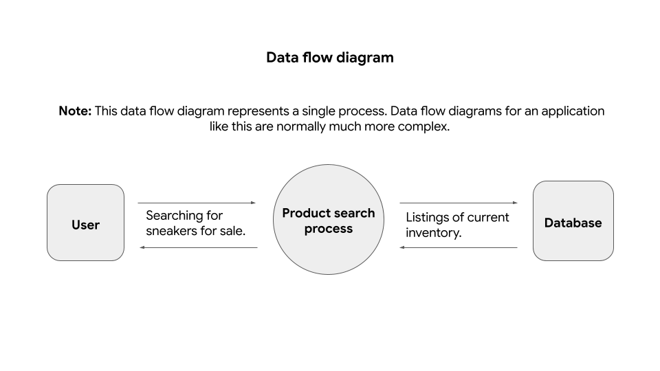
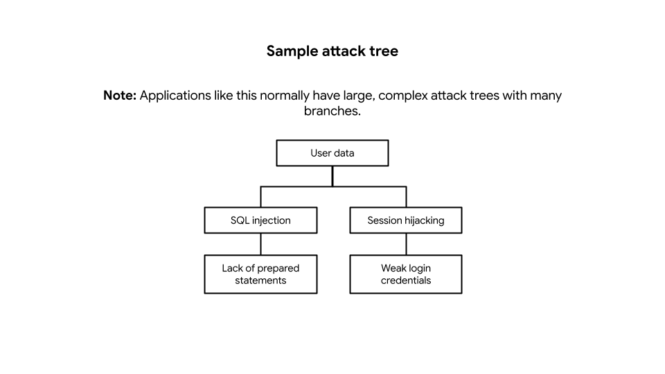

# PASTA Threat Model Worksheet: Sneaker company

Completed threat modeling analysis of the **Process of Attack Simulation and Threat Analysis (PASTA)** framework.

## I. Define business and security objectives

Make 2-3 notes of specific business requirements that will be analyzed.
_______

**Will the app process transactions?**
- The app provides several payment options for checkout.

**Does it do a lot of back-end processing?**
- The app handles high-volume database queries for sneaker listings, user accounts, and real-time messaging.

**Are there industry regulations that need to be considered?**
- PCI-DSS must be considered because the application handles credit card and payment data.

## II. Define the technical scope

List of technologies used by the application:
- Application Programming Interface (API)
- Public Key Infrastructure (PKI)
- SHA-256
- SQL

Write 2-3 sentences (40-60 words) that describe why one technology is prioritized over the others.
_______
Prioritize SQL for proper payment handling and avoidance of SQL injection to prevent legal issues and data manipulation or theft. SQL directly interacts with the database that contains sensitive customer and seller information, including PII and transaction records. To ensure business regulatory compliance (PCI-DSS) is met, this technology should be prioritized.

## III. Decompose application

*Note: The diagram is provided by the course*

## IV. Threat analysis

List 2 types of threats in the PASTA worksheet that are risks to the information being handled by the application.
_______
- SQL Injection
- Unauthorized API Access

**What are the internal threats?**
- Internal threats originate within the organization with unintentional or malicious intentions. Examples include current or former employees misusing their privileges, or negligence. The result can be a compromised system or a vulnerability, such as an API allowing unauhtorized access.

**What are the external threats?**
- External threats originate outside the organizaiton. External attackers do not have authorized access to the application and must find a vulnerbaility to exploit. Examples include phishing, ransomware, and SQL Injection.

## V. Vulnerability analysis

List 2 vulnerabilities in the PASTA worksheet that could be exploited.
_______
- Lack of prepared statements
- Broken API token

**Could there be things wrong with the codebase?**
- Codebase flaws come from how the application code is written and can directly introduce vulnerabilities. Examples include:
    - Passing raw user input straight into SQL queries instead of using prepared statements
    - Returning raw/detailed database error messages that reveal the database structure, such as table or column names
    - Failing to validate API tokens and user permissions on endpoints

**Could there be weaknesses in the database?**
- Database weaknesses come from how the database is configured or how it executes queries. Examples include:
    - Users or roles with database permissions having excessive privileges instead of least privilege
    - Running dynamic queries without parameterization, allowing unauthorized data manipulation

**Could there be flaws in the network?**
- Network flaws relate to how data and authentication tokens travel across the network. For API traffic, this includes:
    - Weak transport encryption, which allows an unauthorized actor to intercept and replay tokens in transit to impersonate a valid user
    - Missing rate limits, which allow attackers to send automated, high volume requests at an unrestricted pace

## VI. Attack modeling

## VII. Risk analysis and impact

List 4 security controls that you’ve learned about that can reduce risk.
_______
- **Password policy:** Enforces strong credentials to help protect accounts against unauthorized access.
- **Principle of least privilege:** Restricts permissions to only what is necessary for a user or role. 
- **Parameterized queries:** Uses prepared statements to prevent SQL injection.
- **Incident response procedures:** Defines a clear plan for certain scenarios to reduce impact if an incident occurs, such as SQL injection or unauthorized API access.
